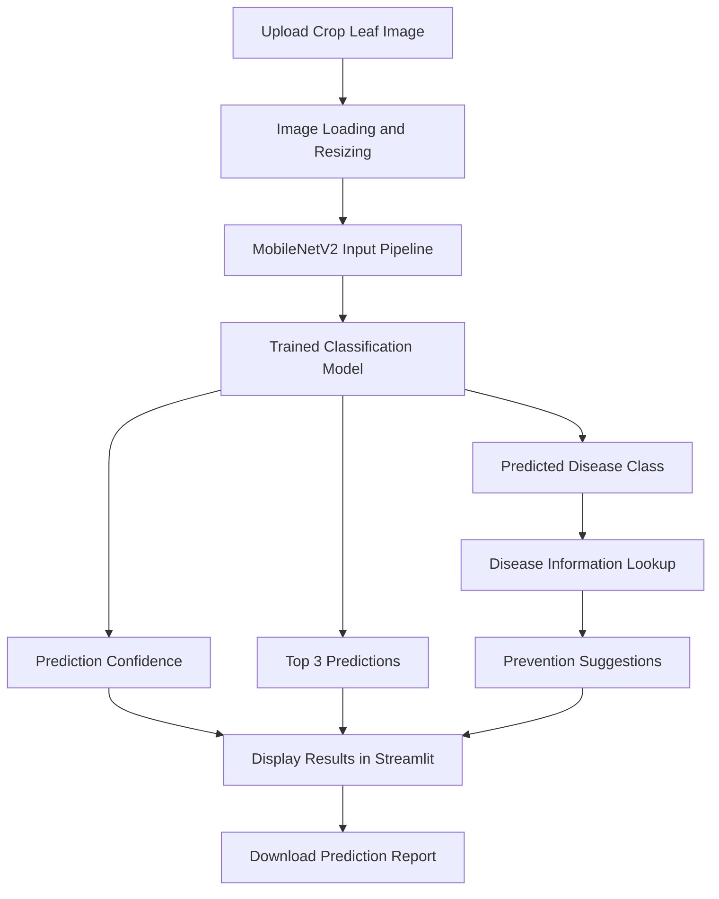

# 🌿 AI-Based Crop Disease Detection & Prevention System

### Deep Learning • Computer Vision • Transfer Learning • Precision Agriculture

**An AI-powered application that identifies potential crop diseases from leaf images and provides disease information and prevention guidance.**

[](https://www.python.org/)
[](https://www.tensorflow.org/)
[](https://keras.io/)
[](https://streamlit.io/)
[](https://opencv.org/)
[]()

---

## 🌱 Project Overview

Plant diseases can significantly affect crop quality, agricultural productivity, and farmers' income. Identifying diseases early can help farmers take appropriate preventive action before the problem spreads.

This project uses **deep learning and image classification** to analyze an uploaded crop leaf image, predict its likely disease category, display the model's confidence score, and provide relevant disease information and prevention suggestions.

The application combines a trained **MobileNetV2 transfer-learning model** with a simple, interactive Streamlit interface, making the system accessible without requiring users to run Python commands for each prediction.

### ✨ Key Highlights

- 🌿 **38-class classification:** Supports the 38 categories represented in the configured PlantVillage dataset.
- 🧠 **Transfer learning:** Uses MobileNetV2 with TensorFlow/Keras.
- 📷 **Image-based detection:** Upload a crop leaf image for prediction.
- 📊 **Confidence analysis:** Displays the prediction confidence and top three model predictions.
- 🩺 **Disease information:** Provides disease descriptions and prevention suggestions for supported categories.
- 📄 **Downloadable report:** Generates a text report containing prediction details.
- 📈 **Model evaluation:** Includes classification metrics, confusion matrix, and performance visualizations.
- 💻 **Local web application:** Runs through Streamlit on a local machine.

---

## 🖥️ Application Preview

> **Add your actual screenshots here** after running the application. Screenshots make the project much more compelling to recruiters and reviewers.

<!-- Replace these placeholders with screenshots committed to your repository. -->

| Image Upload | Prediction Results |
|---|---|
| Add screenshot of the image upload interface | Add screenshot showing the predicted class and confidence |

| Model Evaluation | Performance Analysis |
|---|---|
| Add confusion matrix screenshot | Add accuracy, precision, recall, and F1-score graph |

---

## ⚙️ How It Works

The system follows an image-classification pipeline from input to prediction.



### 🔍 Workflow

1. **Image input:** The user uploads an image of a crop leaf.
2. **Image preparation:** The image is converted into the expected RGB format and resized to `160 × 160` pixels.
3. **Model inference:** The trained MobileNetV2-based model processes the image and generates class probabilities.
4. **Classification:** The class with the highest predicted probability is selected.
5. **Result presentation:** The application displays the predicted category, confidence score, and top three predictions.
6. **Prevention guidance:** The application retrieves available disease information and prevention suggestions from its rule-based knowledge dictionary.
7. **Report generation:** The user can download a text report of the prediction.

**Important implementation detail:** The saved model includes its own preprocessing layer. The application therefore passes the RGB image pixels to the model without applying MobileNetV2 preprocessing a second time.

---

## 🧠 Model Architecture

### MobileNetV2 + Transfer Learning

MobileNetV2 is a lightweight convolutional neural network architecture designed for efficient image recognition. Transfer learning allows a pretrained model to be adapted to a new classification task instead of training an entire deep network from scratch.

**Model pipeline**

```text
Input Image (160 × 160 × 3)
          │
          ▼
   Image Preprocessing
          │
          ▼
      MobileNetV2
   Feature Extraction
          │
          ▼
   Classification Head
          │
          ▼
  38-Class Probabilities
          │
          ▼
   Predicted Category
```

### Model Configuration

| Parameter | Configuration |
|---|---|
| Model architecture | MobileNetV2-based transfer learning |
| Deep learning framework | TensorFlow / Keras |
| Input image size | 160 × 160 pixels |
| Input channels | 3 (RGB) |
| Dataset | PlantVillage `color` dataset |
| Number of classes | 38 |
| Batch size during evaluation | 32 |
| Validation split | 20% |
| Evaluation approach | Classification report and confusion matrix |
| Saved model | `crop_disease_model.keras` |
| Class mapping | `class_names.json` |

The exact training configuration, optimizer, loss function, and number of epochs should be documented from the final training script rather than assumed.

---

## 📚 Dataset

The project uses the **PlantVillage color-image dataset**, which contains labeled images of healthy and diseased plant leaves.

The configured dataset contains 38 class categories spanning multiple crops, including tomato, potato, corn, and other plants.

### Dataset Preparation

- Load labeled images from the class-organized dataset directory.
- Resize images to `160 × 160` pixels.
- Use a 20% validation split with a fixed random seed.
- Preserve the class order used by the dataset loader.
- Evaluate predictions against the corresponding validation labels.

### Dataset Directory

```text
color/
├── Apple___...
├── Corn_(maize)___...
├── Potato___...
├── Tomato___...
└── ... additional class folders
```

The exact class folder names depend on the dataset version used.

**Dataset limitation:** Performance on PlantVillage images does not automatically establish performance on real farm images. Backgrounds, lighting, camera quality, multiple diseases, and different crop varieties may affect predictions.

---

## 📊 Model Evaluation

A classification model should be assessed using more than accuracy alone. This project includes evaluation scripts and visualizations to examine both overall and per-class performance.

### Metrics

| Metric | What It Measures |
|---|---|
| Accuracy | Fraction of predictions that are correct |
| Precision | How often predictions for a class are correct |
| Recall | How many actual examples of a class are identified |
| F1-score | Harmonic mean of precision and recall |
| Confusion matrix | Correct and incorrect predictions across classes |

### Generated Evaluation Files

After running `evaluate_model.py`, the `graphs/` directory is intended to contain:

```text
graphs/
├── accuracy.png
├── loss.png
├── history.json
├── classification_report.txt
├── overall_metrics.json
├── per_class_metrics.csv
├── overall_metrics.png
├── per_class_metrics.png
├── metrics_heatmap.png
└── confusion_matrix.png
```

The exact files available depend on which training and evaluation scripts have been run.

### Reported Results

| Evaluation Metric | Result |
|---|---:|
| Accuracy | Add measured value |
| Macro precision | Add measured value |
| Macro recall | Add measured value |
| Macro F1-score | Add measured value |
| Weighted F1-score | Add measured value |

**Use the actual output of `evaluate_model.py` to fill in this table.** Do not substitute training accuracy or peak validation accuracy for an independently measured test result. The current validation split is not a separate test set.

---

## 🛠️ Technology Stack

| Technology | Purpose |
|---|---|
| Python | Core programming language |
| TensorFlow | Deep learning and inference |
| Keras | Model loading and training workflow |
| MobileNetV2 | Image feature extraction and classification |
| NumPy | Numerical operations |
| Matplotlib | Graphs and evaluation visualizations |
| scikit-learn | Classification metrics and confusion matrix |
| Pandas | Exporting per-class evaluation results |
| Streamlit | Interactive web interface |
| PlantVillage | Labeled crop leaf image dataset |
| Git and GitHub | Version control and project hosting |

---

## 📁 Project Structure

```text
Disease-detection/
│
├── app.py
├── train_model.py
├── evaluate_model.py
├── predict_leaf.py
│
├── crop_disease_model.keras
├── class_names.json
│
├── graphs/
│   ├── accuracy.png
│   ├── loss.png
│   ├── confusion_matrix.png
│   ├── overall_metrics.png
│   └── per_class_metrics.png
│
├── test_images/
│   └── test_leaf.jpg
│
├── color/                 # Local dataset; normally excluded from Git
├── .gitignore
├── requirements.txt
└── README.md
```

Your repository may contain fewer files or additional evaluation outputs depending on your final implementation.

---

## 🚀 Installation and Setup

### 1. Clone the repository

```bash
git clone https://github.com/YOUR-USERNAME/crop-disease-detection.git
cd crop-disease-detection
```

Replace `YOUR-USERNAME` with your GitHub username and use your actual repository URL.

### 2. Create a virtual environment

**Windows PowerShell**

```powershell
python -m venv .venv
.\.venv\Scripts\Activate.ps1
```

### 3. Install dependencies

If the project has a `requirements.txt` file:

```powershell
python -m pip install -r requirements.txt
```

Otherwise, install the main dependencies:

```powershell
python -m pip install tensorflow streamlit numpy matplotlib scikit-learn pandas pillow
```

### 4. Prepare the dataset

Place the PlantVillage color dataset in the location expected by the training and evaluation scripts.

For the default project structure:

```text
Disease-detection/
└── color/
    ├── class_1/
    ├── class_2/
    └── ...
```

If you only want to run predictions with an existing trained model, the full training dataset may not be required. Training and validation evaluation do require the dataset.

### 5. Launch the application

```powershell
python -m streamlit run app.py
```

Open the local URL displayed in the terminal, typically:

```text
http://localhost:8501
```

Upload a supported leaf image and review the prediction results.

---

## 🔬 Training and Evaluation

### Train the model

If you want to reproduce the training process and have the required dataset available:

```powershell
python train_model.py
```

This runs the training script and saves the model and training-history outputs according to its configuration.

### Evaluate the model

```powershell
python evaluate_model.py
```

The evaluation script compares predictions with validation labels, calculates classification metrics, and generates the configured graphs and reports.

### Predict a single image

```powershell
python predict_leaf.py
```

Ensure the test image path in the script points to an existing leaf image before running it.

---

## 🌾 Disease Information and Prevention

The application combines neural-network predictions with a rule-based information layer.

For supported disease categories, it displays relevant disease descriptions and prevention suggestions. Other categories may receive general prevention guidance if a specific entry is not defined in the application's dictionary.

Examples of general preventive practices include:

- Monitor plants regularly for unusual leaf spots, discoloration, or wilting.
- Maintain appropriate plant spacing and airflow.
- Use clean tools and suitable sanitation practices.
- Avoid unnecessary leaf wetness and manage irrigation appropriately.
- Seek local agricultural guidance when symptoms are unclear or treatment decisions could affect crop yield.

**Scope:** The current system provides image-based classification and guidance. It does not independently verify a disease in a laboratory, prescribe a guaranteed treatment, or automatically monitor fields using physical IoT sensors.

---

## ⚠️ Limitations

- The model is trained on a specific labeled dataset and may not generalize equally well to field conditions.
- Predictions depend on image quality, lighting, leaf orientation, and visible symptoms.
- Confidence scores represent model output probabilities, not guaranteed diagnostic certainty.
- The disease-information dictionary is rule-based and may not cover every class in equal detail.
- The application does not currently establish whether a disease is spreading across a field.
- Real-time sensor integration, automated irrigation, and physical IoT deployment are not part of the implemented application unless added separately.
- Agricultural treatment decisions should be confirmed with appropriate local expertise.

---

## 🔮 Future Enhancements

Potential extensions include:

- **Field-image validation:** Evaluate the model using images captured under real agricultural conditions.
- **Explainable AI:** Add Grad-CAM visualizations to highlight image regions influencing predictions.
- **Expanded knowledge base:** Provide crop-specific disease symptoms, prevention methods, and verified agricultural resources.
- **Multilingual interface:** Support Indian languages to improve accessibility.
- **Mobile-friendly deployment:** Make the application easier to use in the field.
- **IoT integration:** Explore environmental sensors for temperature, humidity, and soil-moisture monitoring.
- **Weather-aware risk analysis:** Combine relevant environmental information with disease monitoring.
- **Model optimization:** Investigate quantization and efficient deployment for low-resource devices.
- **Robust evaluation:** Use an independent test set and field images to better assess real-world generalization.

These are proposed improvements, not claims about features already implemented.

---

## 👩‍💻 Author

**Kaveri Kapgate**

B.Tech Computer Science Engineering

Interested in Artificial Intelligence, Machine Learning, Computer Vision, and practical software engineering.


Replace the placeholders with your actual profile details.

---

## 📌 Project Status

**Academic AI/ML project — image classification and prevention-guidance prototype.**

The current implementation focuses on crop leaf image classification, model evaluation, and an interactive Streamlit application. Future work can extend it toward field-tested disease monitoring and IoT-enabled precision agriculture.

---

## ⭐ Support

If you find this project useful for learning about deep learning, transfer learning, or agricultural computer vision, consider giving the repository a star.

**Built to explore how AI can support smarter and more accessible crop-health monitoring.** 🌱
